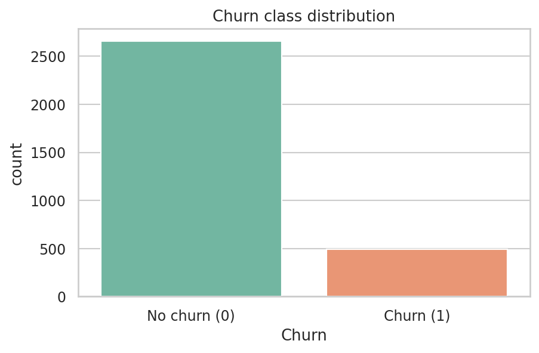
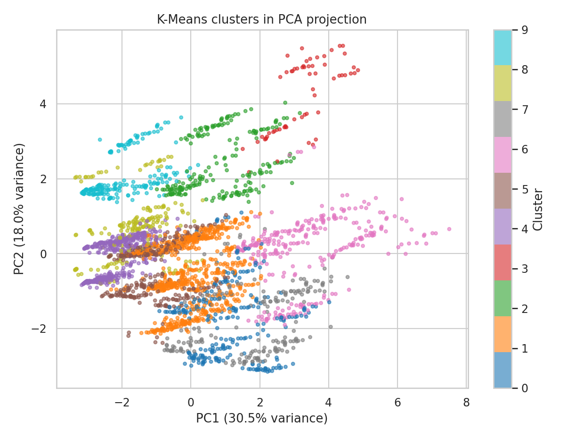

# تحلیل ریزش مشتری در ایران | تحلیل داده، دسته‌بندی و خوشه‌بندی

[**English — README.md**](README.md) · **فارسی**

این مخزن یک پروژه نمونه‌کار در حوزه **داده‌کاوی و یادگیری ماشین** روی دیتاست مشترکان یک شرکت مخابراتی ایرانی است. پروژه سه بخش دارد: **تحلیل اکتشافی داده (EDA)**، **دسته‌بندی ریزش مشتری** با KNN و درخت تصمیم، و **خوشه‌بندی مشتریان** با K-Means.

> **نکته درباره اصالت پروژه:** سه کد پایتون اولیه و سه گزارش فارسی از فایل‌های ارائه‌شده توسط صاحب پروژه گرفته شده‌اند و کدهای اولیه بدون تغییر در `original_code/` نگهداری می‌شوند. نسخه‌های منظم، قابل‌اجرا، نمودارها و نتایج جدید از همان دیتاست تهیه شده‌اند. اعداد زیر **نتایج اجرای نسخه اصلاح‌شده** هستند و نباید به‌عنوان نتایج اجرای بدون تغییر کدهای قدیمی معرفی شوند.

## خلاصه داده و نتایج

| شاخص | نتیجه |
|---|---:|
| تعداد رکوردهای دیتاست اصلی | 3,150 |
| تعداد ویژگی‌های ورودی | 13 |
| برچسب هدف | `Churn`؛ مقدار ۱ به معنی ریزش |
| نسبت ریزش در دیتاست اصلی | 15.7% |
| داده گمشده | 0 |
| تعداد ردیف‌های کاملاً تکراری | 300 |
| داده‌های آموزش و آزمون بعد از حذف تکراری‌ها | 1,995 / 855 |
| مدل دسته‌بندی منتخب | **KNN (k=5)** |
| دقت (Accuracy) روی آزمون | **93.68%** |
| Precision برای کلاس ریزش | **78.99%** |
| Recall برای کلاس ریزش | **81.34%** |
| F1-score برای کلاس ریزش | **80.15%** |
| معیار ROC AUC روی آزمون | **0.955** |
| تعداد خوشه انتخاب‌شده K-Means | **10** |
| امتیاز Silhouette تخمینی | **0.306** (نمونه ۱۰۰۰تایی) |

## ۱. تحلیل اکتشافی داده (EDA)

در بخش EDA شاخص‌های آماری (میانگین، میانه، مد، واریانس و انحراف معیار)، توزیع کلاس‌ها، نمودارهای هیستوگرام و جعبه‌ای و همبستگی ویژگی‌ها بررسی می‌شوند.




خروجی‌های این بخش در `figures/eda/` و `results/eda_descriptive_statistics.csv` قرار دارند.

## ۲. دسته‌بندی با KNN و Decision Tree

در کد اولیه دو خانواده الگوریتم استفاده شده است:

- **KNN** با تعداد همسایه‌های ۵، ۷ و ۱۳.
- **درخت تصمیم** با عمق‌های ۳، ۵ و ۸.

در نسخه اصلاح‌شده، ابتدا سطرهای کاملاً تکراری حذف می‌شوند، سپس با حفظ نسبت کلاس‌ها داده‌ها **۷۰ درصد آموزش و ۳۰ درصد آزمون** تقسیم می‌شوند. هر شش مدل با **اعتبارسنجی متقاطع طبقه‌بندی‌شده ۱۰بخشی روی آموزش** مقایسه شده و بهترین مدل با F1 کلاس ریزش انتخاب می‌شود. داده‌های آزمون فقط پس از انتخاب مدل استفاده می‌شوند. استانداردسازی و جایگذاری مقادیر خالی در `Pipeline` قرار دارند تا از نشت اطلاعات جلوگیری شود.


جزئیات معیارها در `results/classification_test_metrics.json` و نسخه آموزش‌دیده مدل در `models/best_classifier.joblib` است؛ **مدل ذخیره‌شده را فقط از منابع قابل‌اعتماد بارگذاری کنید**.

## ۳. خوشه‌بندی با K-Means

مدل‌های K-Means برای تعداد خوشه **۲ تا ۱۲** اجرا شده‌اند. برای بررسی کیفیت از **Silhouette** (بیشتر بهتر) و **Davies–Bouldin** (کمتر بهتر) استفاده شده است. مقدار Silhouette روی نمونه تصادفی ثابتِ ۱۰۰۰ ردیفی محاسبه می‌شود تا اجرای پروژه سنگین نشود.

**برچسب `Churn` در آموزش خوشه‌بندی استفاده نشده است.** پس از تعیین خوشه‌ها، درصد ریزش هر خوشه صرفاً برای تفسیر و شناخت گروه‌ها گزارش شده است؛ شماره خوشه معادل برچسب صفر/یک نیست.




خلاصه کیفیت و مشخصات خوشه‌ها در `results/clustering_summary.json` و `results/clustering_cluster_profile.csv` قرار دارند.

## ساختار پوشه‌ها

```text
customer-churn-machine-learning/
├── README.md                   # توضیحات انگلیسی
├── README.fa.md                # توضیحات فارسی
├── requirements.txt            # کتابخانه‌های موردنیاز
├── run_all.py                  # اجرای سه بخش
├── data/                       # CSV اصلی و منبع داده
├── eda/eda.py                  # کد جدید تحلیل اکتشافی
├── classification/classification.py
├── clustering/clustering.py
├── original_code/              # هر سه کد اولیه، بدون تغییر
├── reports/                    # هر سه گزارش PDF فارسی (حذف اطلاعات شناسایی)
├── figures/                    # نمودارهای تولیدشده
├── results/                    # خروجی‌های آماری و ارزیابی
├── models/                     # مدل دسته‌بندی آموزش‌دیده
├── docs/METHODOLOGY.md         # تفاوت‌ها و محدودیت‌های فنی
├── tests/                      # آزمایش صحت ساختار داده
└── .github/workflows/          # بررسی‌های خودکار در GitHub
```

## روش اجرا روی کامپیوتر

به **Python 3.10 یا جدیدتر** نیاز دارید. فایل CSV داخل پروژه است و اجرای نسخه جدید نیازی به دانلود اینترنتی دیتاست ندارد.

در ترمینال داخل پوشه اصلی پروژه:

```bash
python -m venv .venv
```

فعال‌سازی محیط مجازی:

- ویندوز PowerShell: `.venv\Scripts\Activate.ps1`
- ویندوز CMD: `.venv\Scripts\activate.bat`
- لینوکس و مک: `source .venv/bin/activate`

سپس:

```bash
python -m pip install -r requirements.txt
python run_all.py
```

در صورت تمایل، هر بخش را جداگانه اجرا کنید:

```bash
python eda/eda.py
python classification/classification.py
python clustering/clustering.py
```

برای آزمایش اولیه صحت دیتاست:

```bash
python -m unittest discover -s tests -v
```

## تفاوت نسخه اصلی و بازنویسی‌شده

سه اسکریپت اولیه همان فایل‌های ارسالی هستند، اما برای ارائه مناسب در GitHub نسخه‌های تازه‌ای نیز اضافه شده‌اند که مسیر فایل‌ها، ذخیره نمودارها، وابستگی‌ها، ارزیابی و استانداردسازی را اصلاح می‌کنند. در کد قدیمی، استانداردسازی آموزش و آزمون مستقل بود، حذف سطرهای تکراری عملاً اعمال نشده بود و در خوشه‌بندی، شماره خوشه با برچسب ریزش مستقیماً مقایسه می‌شد؛ این موارد در نسخه جدید اصلاح شده‌اند.

گزارش‌های فارسی اصلی در `reports/` با حذف مشخصات شناسایی جلد نگهداری شده‌اند. **محتوای گزارش‌ها قدیمی است** و ممکن است اعداد یا روش آن‌ها با پیاده‌سازی جدید فرق داشته باشد. برای تفسیر نتایج جدید به پوشه `results/` مراجعه کنید.

## محدودیت‌های پروژه

- داده‌ها تاریخی و متعلق به یک مجموعه مخابراتی‌اند؛ نتایج، تضمینی برای عملکرد در صنعت نیست.
- داده‌ها نامتوازن‌اند و صرفاً اتکا به Accuracy مناسب نیست.
- حذف سطرهای کاملاً یکسان یک تصمیم مدل‌سازی است؛ بدون شناسه یکتای مشتری ممکن است بعضی ردیف‌ها مربوط به مشتریان واقعی متفاوت باشند.
- Silhouette از یک **نمونه ۱۰۰۰ ردیفی** به دست آمده است؛ نمایش PCA فقط تصویر دوبعدی تقریبی از ساختار داده است.
- این پروژه نمونه‌کار آموزشی/پژوهشی است و سیستم آماده استقرار تجاری محسوب نمی‌شود.

## منبع دیتاست و مجوز

**Iranian Churn [Dataset]. (2020). UCI Machine Learning Repository.**

DOI: https://doi.org/10.24432/C5JW3Z

وب‌سایت: https://archive.ics.uci.edu/dataset/563/iranian+churn+dataset

این مجموعه‌داده با مجوز **CC BY 4.0** قابل استفاده و بازنشر با ذکر منبع است. مجوز دیتاست به معنی تعیین خودکار مجوز متن‌باز برای کدهای پروژه نیست؛ انتشار مجوز کد با تصمیم صاحب پروژه است.
