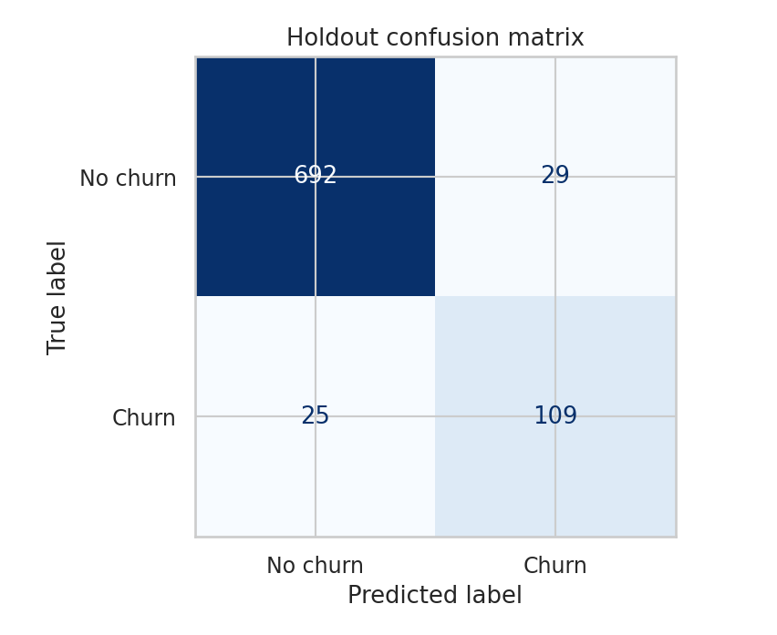
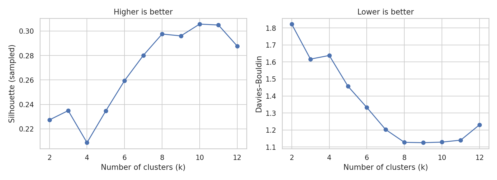

# تحلیل ریزش مشتریان مخابراتی ایران

**تحلیل اکتشافی داده · دسته‌بندی · خوشه‌بندی**

[English version](README.md)

ریزش مشتری (Customer Churn) یکی از مسائل مهم در کسب‌وکارهای اشتراکی است. در این پروژه، داده‌های مشتریان یک شرکت مخابراتی بررسی شده تا الگوهای مرتبط با ریزش مشخص شوند. علاوه بر تحلیل آماری، از الگوریتم‌های دسته‌بندی برای پیش‌بینی ریزش و از خوشه‌بندی برای شناسایی گروه‌های مشابه مشتریان استفاده شده است.

## مجموعه‌داده

داده‌ها از [Iranian Churn در UCI](https://archive.ics.uci.edu/dataset/563/iranian+churn+dataset) گرفته شده‌اند. ستون `Churn` متغیر هدف است و مقدار `1` نشان‌دهنده ریزش مشتری است.

| مشخصه | مقدار |
| --- | ---: |
| تعداد رکورد | ۳۱۵۰ |
| تعداد ویژگی ورودی | ۱۳ |
| درصد ریزش | ۱۵٫۷٪ |
| مقادیر گمشده | ۰ |
| ردیف‌های کاملاً تکراری | ۳۰۰ |

فایل CSV در پوشه [`data/`](data/) قرار دارد. در بخش مدل‌سازی، ردیف‌های کاملاً تکراری پیش از تقسیم داده حذف شده‌اند و ۲۸۵۰ رکورد باقی مانده است.

## بخش‌های پروژه

### ۱. تحلیل اکتشافی داده (EDA)

در این مرحله، شاخص‌هایی مانند میانگین، میانه، انحراف معیار و همچنین توزیع ویژگی‌ها، توزیع کلاس ریزش و ارتباط بین متغیرها بررسی شده‌اند.


نمودارها در [`figures/eda/`](figures/eda/) و جدول‌های آماری در [`results/`](results/) ذخیره می‌شوند.

### ۲. دسته‌بندی (Classification)

برای پیش‌بینی ریزش، دو الگوریتم با تنظیمات مختلف مقایسه شده‌اند:

- **KNN:** تعداد همسایه‌های ۵، ۷ و ۱۳
- **Decision Tree:** عمق‌های ۳، ۵ و ۸

۷۰ درصد داده‌ها برای آموزش و ۳۰ درصد برای آزمون استفاده شده است. انتخاب مدل با اعتبارسنجی متقاطع ۱۰بخشی روی داده آموزش و بر اساس F1 کلاس ریزش انجام می‌شود. پیش‌پردازش نیز فقط با داده آموزشی تنظیم شده است.

| معیار روی داده آزمون | نتیجه |
| --- | ---: |
| مدل انتخاب‌شده | KNN با ۵ همسایه |
| Accuracy | ۹۳٫۶۸٪ |
| Precision کلاس ریزش | ۷۸٫۹۹٪ |
| Recall کلاس ریزش | ۸۱٫۳۴٪ |
| F1-score کلاس ریزش | ۸۰٫۱۵٪ |
| ROC AUC | ۰٫۹۵۵ |



جزئیات معیارها در فایل [`results/classification_test_metrics.json`](results/classification_test_metrics.json) آمده است.

### ۳. خوشه‌بندی (Clustering)

الگوریتم K-Means با تعداد خوشه‌های ۲ تا ۱۲ اجرا شده است. برای مقایسه خوشه‌بندی‌ها از Silhouette Score و Davies–Bouldin Index استفاده شده است. بر اساس بیشترین Silhouette در نمونه ثابت ۱۰۰۰تایی، **۱۰ خوشه** انتخاب شده‌اند (Silhouette تقریباً **۰٫۳۰۶**).

ستون `Churn` در آموزش K-Means استفاده نمی‌شود؛ درصد ریزش هر خوشه فقط بعد از خوشه‌بندی و برای تفسیر گروه‌ها محاسبه می‌شود.



## ساختار پروژه

```text
customer-churn-machine-learning/
├── data/                   # دیتاست
├── eda/                    # تحلیل اکتشافی
├── classification/         # الگوریتم‌های دسته‌بندی
├── clustering/             # الگوریتم خوشه‌بندی
├── figures/                # نمودارها
├── results/                # جدول‌ها و معیارهای ارزیابی
├── models/                 # مدل آموزش‌دیده
├── reports/                # گزارش‌های درس (PDF)
├── original_code/          # اسکریپت‌های اولیه درس
├── docs/                   # توضیح روش کار
├── tests/                  # تست‌های صحت داده
├── run_all.py
├── requirements.txt
├── README.md
└── README.fa.md
```

## روش اجرا

پایتون نسخه ۳.۱۰ یا جدیدتر پیشنهاد می‌شود. در پوشه اصلی پروژه دستورهای زیر را اجرا کنید:

```bash
python -m pip install -r requirements.txt
python run_all.py
```

برای اجرای جداگانه هر بخش:

```bash
python eda/eda.py
python classification/classification.py
python clustering/clustering.py
```

اجرای تست داده‌ها:

```bash
python -m unittest discover -s tests -v
```

فایل CSV همراه پروژه قرار دارد و برای دریافت داده نیازی به دانلود جداگانه نیست. خروجی‌ها در پوشه‌های `figures/` و `results/` ذخیره می‌شوند.

## نکات و محدودیت‌ها

- معیارهای جدول دسته‌بندی از اجرای کد پوشه `classification/` و داده‌های پس از حذف تکراری‌ها به دست آمده‌اند. گزارش‌های PDF مربوط به تمرین‌های درس هستند و ممکن است محاسبات متفاوتی داشته باشند.
- به دلیل نبود شناسه یکتای مشتری، حذف ردیف‌های کاملاً یکسان یک تصمیم در پیش‌پردازش است.
- خوشه‌بندی یک مسئله بدون ناظر است؛ شماره خوشه، پیش‌بینی صفر یا یک برای ریزش محسوب نمی‌شود.
- نتایج این دیتاست دانشگاهی لزوماً نشان‌دهنده عملکرد مدل روی داده‌های واقعی یک شرکت دیگر نیست.

**منبع داده:** Iranian Churn. (2020). UCI Machine Learning Repository. [DOI: 10.24432/C5JW3Z](https://doi.org/10.24432/C5JW3Z)؛ مجوز مجموعه‌داده: [CC BY 4.0](https://creativecommons.org/licenses/by/4.0/).
