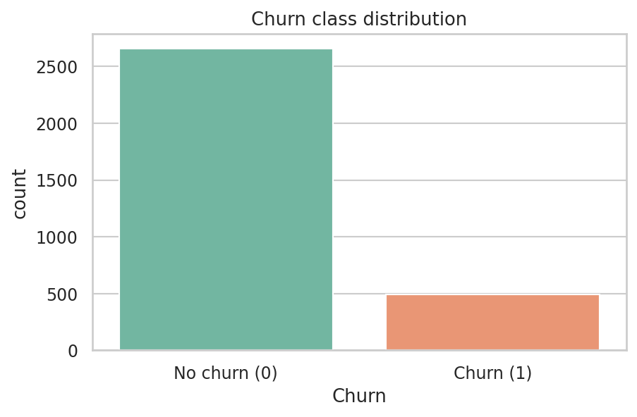
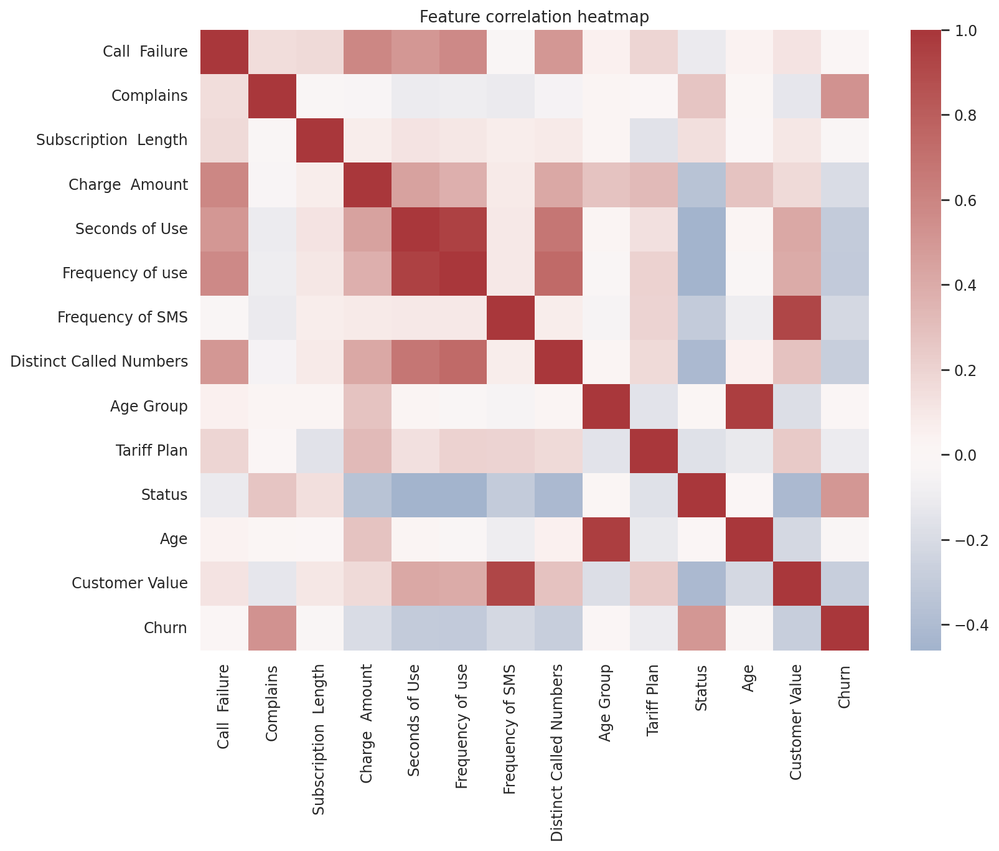
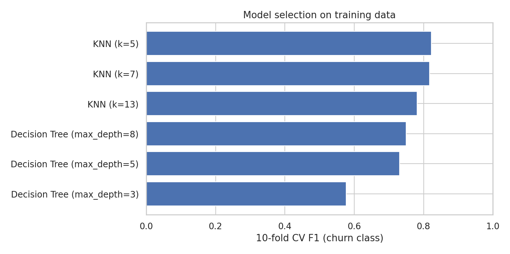
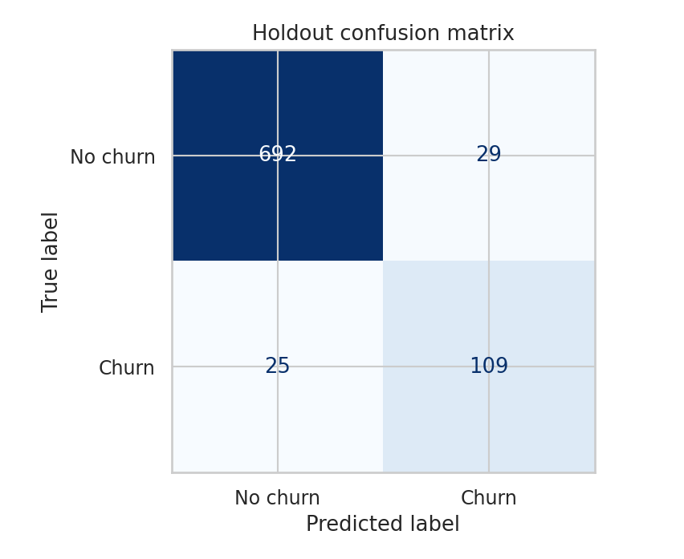
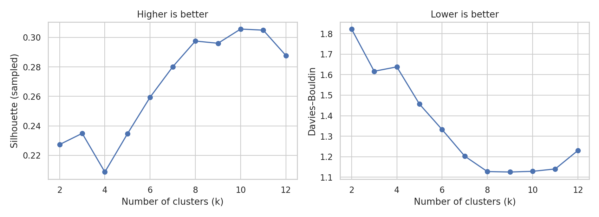
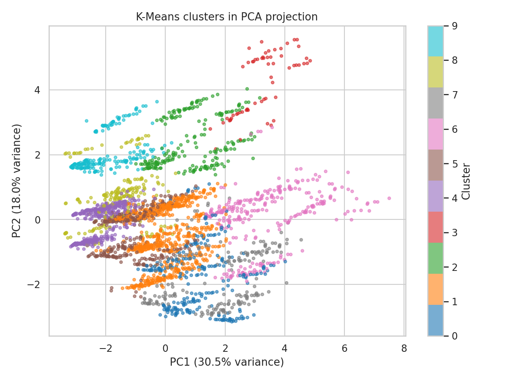

# Iranian Customer Churn | EDA, Classification & Clustering

[**فارسی — README.fa.md**](README.fa.md) · **English**

An end-to-end, reproducible **data-mining / machine-learning portfolio project** based on the Iranian telecom customer churn dataset: **exploratory data analysis (EDA)**, **supervised churn classification**, and **unsupervised customer segmentation**.

> **Project provenance:** The original Python assignments and Persian PDF reports were provided by the project author. This repository preserves those scripts in `original_code/`. The reproducible scripts, figures, metrics, and documentation have been cleaned up and generated from the provided CSV. Therefore, the metrics shown below are results of the **updated implementation**, not results retrospectively attributed to the original scripts.

## At a glance

| Dataset and result | Value |
|---|---:|
| Original observations | 3,150 |
| Predictors | 13 |
| Target | `Churn` (0 = retained, 1 = churned) |
| Positive-class fraction | 15.7% |
| Missing cells in source CSV | 0 |
| Exact duplicate rows removed before ML work | 300 |
| Classification split after deduplication | 1,995 train / 855 test |
| Best classifier (selected by training CV) | **KNN (k=5)** |
| Test accuracy | **93.68%** |
| Test precision (churn = 1) | **78.99%** |
| Test recall (churn = 1) | **81.34%** |
| Test F1 (churn = 1) | **80.15%** |
| Test ROC AUC | **0.955** |
| K-Means selected k | **10** (maximum sampled silhouette) |
| K-Means silhouette | **0.306** (1,000-row sample) |

### 1. Exploratory data analysis

Descriptive statistics (mean, median, mode, population variance, standard deviation), target imbalance, boxplots, histograms, and feature correlation heatmap.





### 2. Supervised classification

The original work trained **K-Nearest Neighbors** with `k=5, 7, 13` and **Decision Trees** with `max_depth=3, 5, 8`.

In the revised version, a **stratified 70/30 holdout split** is created **after exact-duplicate removal**. For each candidate, a **10-fold stratified CV** on training data estimates positive-class F1. Scaling and missing-value imputation occur **inside a scikit-learn Pipeline**, avoiding train/test and validation leakage. The model with the highest CV F1 is evaluated once on the untouched holdout test set.





Additional evaluation: precision, recall, ROC AUC, average precision, ROC and precision–recall plots. A fitted classifier is saved to `models/best_classifier.joblib` (only load serialized models you trust).

### 3. Unsupervised clustering

**K-Means** is fitted to standardized predictor features **without `Churn`** for `k = 2 ... 12`. The maximum sampled Silhouette score determines the displayed solution; Davies–Bouldin scores are also reported. After clustering, the original `Churn` field is used **only to describe clusters**, not to fit or select them. Cluster IDs are arbitrary and must **not** be compared directly to class labels as if they were predictions.





## Repository files

```text
customer-churn-machine-learning/
├── README.md                   # English
├── README.fa.md                # فارسی
├── requirements.txt
├── run_all.py                  # Runs the three updated scripts
├── data/
│   ├── CustomerChurn.csv
│   └── README.md                # Attribution + dataset license
├── eda/eda.py
├── classification/classification.py
├── clustering/clustering.py
├── original_code/              # Three original Python files, unchanged
├── reports/                    # Three original Persian PDF reports, identifying details redacted
├── figures/                    # Reproduced PNG plots by task
├── results/                    # Computed CSV, JSON, and evaluation TXT files
├── models/best_classifier.joblib
├── docs/METHODOLOGY.md         # Changes, limitations and interpretation
├── tests/test_data_integrity.py
└── .github/workflows/check.yml # Basic GitHub Actions checks
```

## Run locally

Requires **Python 3.10+**. No internet is needed for data loading; the CSV is included.

```bash
# From the extracted repository folder:
python -m venv .venv
```

Activate the virtual environment:

- Windows PowerShell: `.venv\Scripts\Activate.ps1`
- Windows CMD: `.venv\Scripts\activate.bat`
- Linux/macOS: `source .venv/bin/activate`

Then:

```bash
python -m pip install -r requirements.txt
python run_all.py
python -m unittest discover -s tests -v
```

You can also run each stage independently:

```bash
python eda/eda.py
python classification/classification.py
python clustering/clustering.py
```

Outputs are written into `figures/`, `results/`, and `models/`. The included plots and metrics were actually generated from the included dataset.

## Original work vs. revised implementation

**Original files** are unchanged under `original_code/`; the three original PDF coursework reports remain in `reports/`, with **only identifying cover-page details redacted for public sharing**. Those reports may describe choices or older results that differ from the revised pipeline. The original scripts call `fetch_ucirepo(id=563)` even though they also load the local CSV; the updated scripts avoid this unnecessary online dependency.

Key improvements: reproducible execution, corrected preprocessing and fitted scaling, duplicate removal before splitting, stratification, leakage-aware cross-validation, real saved evaluation results, meaningful (non-label-based) clustering evaluation, and graphical artifacts.

More detail: [Methodology, corrections, and limitations](docs/METHODOLOGY.md).

## Limitations

- The dataset is small and from a single historical telecom source, so performance may not generalize to real deployment.
- Churn is an imbalanced target; accuracy alone is insufficient. F1, precision, recall and PR performance matter.
- Deduplication is a modeling decision: exact duplicate rows may represent legitimate different customers, as no anonymous unique customer ID is present in the provided CSV. Results depend on this choice.
- Silhouette is **estimated on a fixed 1,000-row sample**, not on all records; the PCA chart is a projection, not proof of cluster separation.
- This is a portfolio demonstration, **not** a production churn prediction service or causal analysis.

## Dataset credit and license

**Iranian Churn [Dataset]. (2020). UCI Machine Learning Repository.** https://doi.org/10.24432/C5JW3Z

UCI dataset page: https://archive.ics.uci.edu/dataset/563/iranian+churn+dataset

The **dataset** is supplied under **Creative Commons Attribution 4.0 International (CC BY 4.0)**; the required attribution is provided above. This does not automatically give the project code an open-source software license. A software license can be added by the author if desired.
